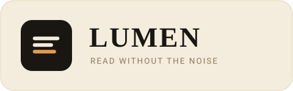

# Lumen




> **A calm, typographic reading mode for Chrome.** One shortcut, and the page becomes the article: no ads, no sidebars, no cookie banners, no scripts, no network calls.

Lumen is a complete, self-contained reader mode written from scratch — extraction engine, typography, themes, Markdown export and settings page included. It has no runtime dependencies, no build step and no host permissions. Nothing leaves your machine, because there is nothing to send.

**🇫🇷 [En bref (FR)](#en-bref-fr)** — résumé du projet en français, plus bas.

---

## Table of contents

- [Why Lumen](#why-lumen)
- [Features](#features)
- [Install](#install)
- [Usage](#usage)
- [Keyboard shortcuts](#keyboard-shortcuts)
- [Permissions](#permissions)
- [How it works](#how-it-works)
- [Project layout](#project-layout)
- [Development](#development)
- [Testing](#testing)
- [Design notes](#design-notes)
- [Limitations](#limitations)
- [Roadmap](#roadmap)
- [Changelog](#changelog)
- [License](#license)
- [En bref (FR)](#en-bref-fr)

---

## Why Lumen

Most reader modes are either a thin CSS trick — hide the sidebar, hope for the best — or a bundled copy of a large third-party extraction library with its own tracking surface. Lumen takes the opposite route:

- **The extraction is the product.** A ~21 KB scoring engine decides what the article is, prunes boilerplate, and rebuilds a clean document from an allowlist of tags. No library, no magic.
- **The reader is a room, not a skin.** A Shadow DOM overlay with its own typography scale, its own palette and its own scrolling. The host page cannot style it; Lumen cannot leak styles into the host page.
- **Silence by default.** No content script is registered on any site. Lumen is injected only after you click its button or press `Alt+R` on that specific tab, under an `activeTab` grant.
- **Text you can keep.** One keystroke exports the cleaned article as Markdown — title, byline, site, source URL, then the body.

The result is small enough to read in an afternoon and honest enough to audit in ten minutes.

---

## Features

**Reading**

- Self-contained article extraction with block scoring, link-density penalties and `<article>` / `<main>` detection.
- Boilerplate pruning: navigation, asides, footers, comment sections, newsletters, cookie walls.
- Light DOM sanitiser that keeps a fixed allowlist of tags and attributes — no scripts, no inline handlers, no remote images smuggled in as HTML.
- Reading progress bar pinned to the top of the overlay.
- Estimated reading time, byline and site name in the header.
- Print-friendly typography: serif body, generous leading, hanging punctuation-friendly measure.

**Typography**

- Three themes: **Sepia** (warm paper), **Light** (neutral white), **Ink** (true dark).
- Text size from **15 px to 30 px**, adjustable live with `+` / `−`.
- Measure (line length) from **44 to 92 characters**, cycled with `W`.
- Settings persist in `chrome.storage.sync` and apply to every future article.

**Output**

- Markdown export via `E`, with `Blob` download — no clipboard permission, no server.
- Options page with defaults, a live preview and the shortcut reference.

**Engineering**

- Manifest V3 service worker, no content scripts declared in the manifest.
- **Zero dependencies**, zero build step, zero network calls, zero telemetry.
- 15 unit tests on Node's built-in test runner — no test framework to install.
- Icon rasterised at runtime from the same geometry as the Python generator, so the repository stays text-only and the two can never drift apart.

---

## Install

Lumen is not on the Chrome Web Store. It installs as an unpacked extension in about thirty seconds.

```bash
git clone https://github.com/cbdu34/lumen-reader.git
```

Then:

1. Open `chrome://extensions` in Chrome (or any Chromium browser: Edge, Brave, Arc, Vivaldi).
2. Turn on **Developer mode** (top right).
3. Click **Load unpacked** and select the `lumen-reader` folder — the one containing `manifest.json`.
4. Pin **Lumen** to the toolbar (puzzle-piece icon → pin).
5. Open any article and press `Alt+R`.

There is no `npm install`, no bundler and no generated asset to fetch: the folder on disk *is* the extension.

> **Reading local files?** To use Lumen on `file://` pages, open the extension's details in `chrome://extensions` and enable **Allow access to file URLs**.

---

## Usage

Open an article, then press **`Alt+R`** (or click the toolbar button). The overlay replaces the page with the extracted text. Press `Alt+R` again, or `Esc`, to return to the original page — Lumen never navigates, so the site keeps its scroll position and state.

While the reader is open:

| Key | Action |
| --- | --- |
| `+` / `−` | Increase / decrease text size |
| `W` | Cycle the column width |
| `T` | Cycle the theme (Sepia → Light → Ink) |
| `E` | Export the article as Markdown |
| `?` | Show the shortcut panel |
| `Esc` | Close the reader |

The toolbar badge tells you what happened when nothing appears:

- **`✕`** — this page cannot be read (`chrome://` pages, the Web Store, PDF viewers, the new tab page).
- **`!`** — injection was refused (for example, a page that forbids script injection).

Theme, text size and column width are saved as you change them. **Restore defaults** on the options page resets all three; shortcuts can be rebound at `chrome://extensions/shortcuts`.

---

## Keyboard shortcuts

| Scope | Key | Action |
| --- | --- | --- |
| Any page | `Alt` + `R` | Open or close the reader on the current tab |
| Reader open | `Esc` | Close the reader |
| Reader open | `+` / `−` | Text size, one pixel at a time |
| Reader open | `W` | Cycle the column width |
| Reader open | `T` | Cycle the theme |
| Reader open | `E` | Export the article as Markdown |
| Reader open | `?` | Show or hide the shortcut panel |

`Alt+R` is a suggested key: Chrome may leave it unassigned if another extension already claimed it. Rebind it at `chrome://extensions/shortcuts`.

---

## Permissions

Lumen asks for three permissions and nothing else. There are **no host permissions** and **no declared content scripts**.

| Permission | Why it is needed | What it does *not* allow |
| --- | --- | --- |
| `activeTab` | Read the page you are looking at, **only** after you click the button or press the shortcut on that tab. The grant expires when you navigate away. | Silent access to your browsing. Lumen cannot read a tab you have not activated it on. |
| `scripting` | Inject `src/extract.js` and `src/reader.js` into the active tab on demand. | Injecting into other tabs, or on page load. |
| `storage` | Remember your theme, text size and measure in `chrome.storage.sync`. | Reading anything else. No history, no tabs, no cookies, no bookmarks. |

The extension contains no `fetch`, no `XMLHttpRequest`, no `WebSocket`, no remote script and no analytics endpoint. If you want to verify that claim, `grep -rn "fetch\|XMLHttpRequest\|WebSocket" src/` returns nothing.

---

## How it works

```
click / Alt+R
     │
     ▼
background service worker ── ping? ──▶ already injected → toggle
     │ no
     ▼
chrome.scripting.executeScript({ files: [extract.js, reader.js] })
     │
     ▼
extract.js  ── score blocks → pick root → prune → sanitise → blocks → Markdown
     │
     ▼
reader.js   ── Shadow DOM overlay → typography → themes → progress → keys → export
```

### 1. Finding the article

`src/extract.js` scores every plausible container. A candidate is rejected outright if it is too short (`< 140` characters) or if more than 45 % of its text sits inside links — a reliable signature for menus and link farms. Survivors are scored:

```
score = min(textLength / 100, 12)          // substance, capped
      + min(commas × 0.4, 6)               // prose, not labels
      + min(paragraphs × 0.8, 8)           // structure
      + bonus                              // <article> +6, <main> +6, <section> +1
      + images × 1
      + classWeight                        // "article" / "content" +6, "sidebar" / "comment" −8
      × (1 − linkDensity)                  // discount link-heavy blocks
```

The winner is not simply the top score: Lumen keeps every candidate within 90 % of the best score and picks the **deepest** one, which avoids selecting a wrapper that contains the article plus three widgets.

### 2. Cleaning

The chosen subtree is walked and sanitised: navigation, asides, forms, footers and elements whose class or id matches boilerplate patterns are dropped; scripts, styles, iframes and event-handler attributes never survive. Images with relative sources are resolved against the page URL, and `data:` images are kept as-is. Nothing is fetched.

### 3. Rendering

`src/reader.js` builds a single host element with an **open Shadow DOM**. Styles are attached through `adoptedStyleSheets` (with a `<style>` fallback) so the page's CSS cannot reach the overlay, and the overlay's CSS cannot reach the page. Closing removes the host element entirely; the page is untouched.

### 4. Exporting

`blocksToMarkdown` / `buildMarkdown` render the same block model as a Markdown document:

```markdown
# The quiet web

*Ada Lovelace · example.com · 4 min read*

<https://example.com/the-quiet-web>

Reading on the web is a design problem before it is a technological one.
```

The file is downloaded with a `Blob` URL — no clipboard permission, no network request, no server.

---

## Project layout

```
lumen-reader/
├── manifest.json            # Manifest V3, 3 permissions, no host access
├── src/
│   ├── background.js        # service worker: toggle, injection, badge, toolbar mark
│   ├── extract.js           # scoring + pruning + sanitiser + Markdown (UMD, testable)
│   ├── reader.js            # Shadow DOM overlay, typography, themes, shortcuts
│   ├── options.html         # settings page
│   ├── options.css
│   └── options.js
├── tests/
│   └── extract.test.js      # 15 tests, node:test, no dependencies
├── tools/
│   └── generate-icons.py    # store-ready PNGs (stdlib only)
├── assets/
│   └── logo.svg             # wordmark used in this README
├── CHANGELOG.md
├── LICENSE
└── package.json             # scripts only: test, icons
```

`icons/` is intentionally absent — see [Design notes](#design-notes).

---

## Development

Requirements: **Node 18+** for the tests, **Python 3.8+** only if you want to regenerate store icons. Neither is needed to run the extension.

```bash
npm test          # 15 unit tests, no dependencies, no install step
npm run icons     # writes icons/icon{16,32,48,128}.png (stdlib Python)
```

Reloading after an edit:

- `src/background.js` → the **reload** arrow on the extension card in `chrome://extensions`.
- `src/extract.js` / `src/reader.js` → reload the article tab; the scripts are re-injected on the next toggle.
- `src/options.*` → just reopen the options page.

There is no watcher and no bundler on purpose: the source you edit is the code Chrome runs.

---

## Testing

The test suite targets the pure parts of the extraction engine — the parts where a regression is silent and expensive.

```bash
$ npm test
ℹ tests 15
ℹ pass 15
ℹ fail 0
```

Covered: block scoring and its rejection thresholds, class/id weighting, link density, word counting and reading time, title cleanup, slug generation, URL resolution, whitespace normalisation, block-to-Markdown rendering and full-document Markdown assembly.

DOM-dependent code (the overlay, the settings page) is deliberately not unit-tested: it is exercised by loading the extension, which is faster and more honest than a jsdom approximation.

---

## Design notes

**No content scripts in the manifest.** Declaring a content script would mean code running on every page you visit, and would require either broad host permissions or `activeTab` gymnastics. Lumen instead injects two files on demand. The visible cost is a few milliseconds on first use; the benefit is that an idle browser tab has never heard of Lumen.

**A text-only repository.** The toolbar mark is rasterised at runtime in `src/background.js` (`ImageData` + `chrome.action.setIcon`), using the same rounded-rectangle geometry as `tools/generate-icons.py`. This keeps the repository free of binary blobs that cannot be reviewed in a diff, and guarantees the runtime icon and the store icon cannot diverge. `manifest.json` therefore declares no `icons` key; if you package for the Web Store, run `npm run icons` and add the block back.

**Shadow DOM with `adoptedStyleSheets`.** Constructable stylesheets are shared across every opening instead of re-parsing a `<style>` tag, and the shadow boundary makes selector collisions with the host page structurally impossible rather than merely unlikely.

**Overlay, not navigation.** Lumen never changes the URL and never touches the page's DOM outside its own host element, so closing the reader restores the site exactly — scroll position, video state and all.

**CSP-friendly.** No inline script, no `eval`, no `new Function`, no remote resource. Everything is a static file loaded by the extension itself.

---

## Limitations

- **One column, no infinite scroll.** Lumen reads the document it was given; paginated articles are read one page at a time.
- **Chrome-only surfaces are refused.** `chrome://`, `chrome-extension://`, the Web Store and PDF viewers cannot be scripted — the badge shows `✕` instead of failing silently.
- **Heavily client-rendered pages** may extract a fragment rather than the full text if the article mounts after Lumen runs; reload the reader once the page has settled.
- **No annotation, sync or highlights.** Lumen is a reading surface, not a notebook. Markdown export is the escape hatch.
- **Not published on the Chrome Web Store.** Load it unpacked (see [Install](#install)); a store package needs the generated PNGs.

---

## Roadmap

- [ ] Optional focus mode: dim everything but the paragraph being read.
- [ ] Footnotes collected at the end of the article instead of inline.
- [ ] Tables and code blocks preserved as Markdown in the export.
- [ ] `zh`, `fr` and `es` interface strings.

Ideas and bug reports are welcome as issues. Please keep proposals within the project's constraints: no dependencies, no network, no extra permissions.

---

## Changelog

See [CHANGELOG.md](CHANGELOG.md). Latest: **1.0.0** — first public release.

---

## License

[MIT](LICENSE) © 2026 cbdu34

---

## En bref (FR)

**Lumen** est un mode lecture pour Chrome, écrit de A à Z pour ce projet : aucun code tiers, aucune dépendance, aucun appel réseau.

- **Idée** — un seul raccourci (`Alt+R`) transforme n'importe quel article en une page typographique calme : pas de publicité, pas de barre latérale, pas de bannière cookies.
- **Extraction maison** — `src/extract.js` note les blocs de la page (longueur du texte, nombre de virgules, paragraphes, indices `article`/`main`/`content`), pénalise les zones riches en liens, choisit le conteneur le plus profond parmi les meilleurs scores, puis reconstruit un document propre à partir d'une liste blanche de balises.
- **Rendu isolé** — l'overlay vit dans un Shadow DOM : le CSS du site ne peut pas l'atteindre, et inversement. Trois thèmes (sépia, clair, encre), taille de texte de 15 à 30 px, largeur de colonne de 44 à 92 caractères, barre de progression, export Markdown (`E`).
- **Permissions minimales** — `storage`, `activeTab`, `scripting` uniquement. **Aucune permission d'hôte, aucun content script déclaré** : les scripts ne sont injectés qu'après votre action, sur l'onglet courant.
- **Vie privée** — zéro télémétrie, zéro requête réseau, aucun compte. Les préférences restent dans `chrome.storage.sync`.
- **Qualité** — 15 tests unitaires (`npm test`, sans dépendance), icône de barre d'outils générée à l'exécution, dépôt 100 % texte donc entièrement relisible en diff.

**Installation** : `chrome://extensions` → mode développeur → « Charger l'extension non empaquetée » → dossier `lumen-reader`. Puis `Alt+R` sur un article.

Licence MIT.
